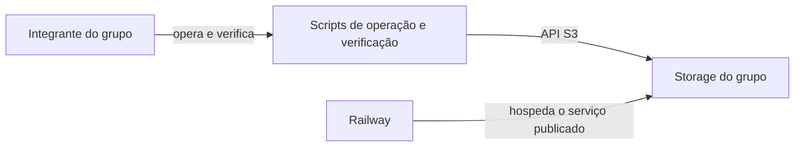
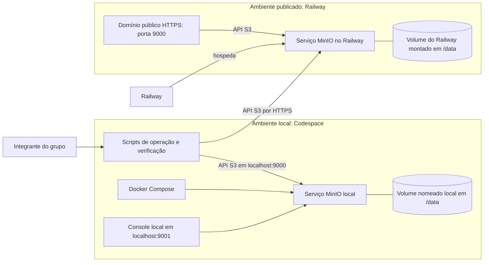
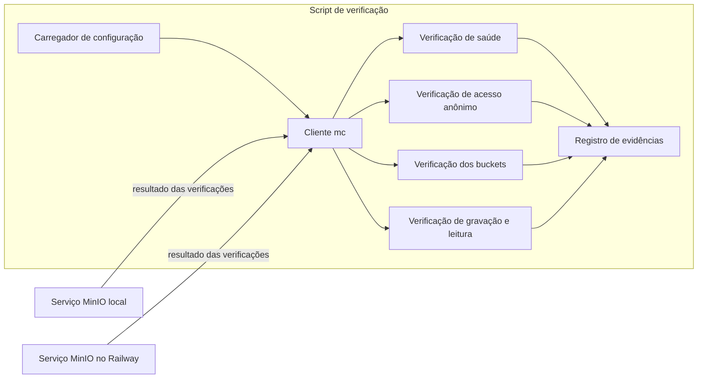

# Plano técnico

> Etapa 4 do SDD. Preenchido pelo prompt 4 a partir de `specs/spec.md`.
> Toda escolha técnica aponta para um RF/RNF ou restrição. Escolha sem origem
> fica marcada como "sem requisito correspondente".

## C4 nível 1: contexto

## C4 nível 2: contêineres

## C4 nível 3: componentes (só onde houver lógica relevante)

## Escolhas técnicas

| Escolha | Alternativas consideradas e motivo do descarte | Requisito ou restrição | ADR previsto |
|---|---|---|---|
| Imagem `ghcr.io/coollabsio/minio:RELEASE.2025-10-15T17-29-55Z`, usada pelo Dockerfile em `minio_railway/` e pelo ambiente local | `minio/minio` antiga: não é a imagem fixada em RES-04; tag `latest` da imagem CoolLabs: não fixa a versão; compilar do código-fonte: não é necessário para atender aos requisitos da spec. | RES-04, RF-03, RNF-02 | ADR-001 |
| Expor publicamente somente a porta 9000 para a API S3; manter a porta 9001 do console apenas local | Publicar também a porta 9001: expõe o console publicamente e contraria o escopo; não publicar a API: impede o acesso HTTPS do RF-01. | RF-01, RES-04; fora do escopo de console web público | ADR-002 |
| Usar Docker Compose no Codespace com a mesma imagem/tag, portas 9000 e 9001, volume nomeado e healthcheck `mc ready local` | Usar imagem/tag diferente: diverge do serviço publicado; não oferecer ambiente local: impede equivalência e verificação local; usar `curl` ou `wget` no healthcheck: não estão disponíveis na imagem indicada. | RF-03, RF-04, RES-04; pedido do Prompt 4 | ADR a definir na etapa 7 |
| Montar o volume do Railway em `/data` | Manter os dados somente no filesystem efêmero do contêiner: não atende à persistência entre deploys; montar em outro caminho: não corresponde ao diretório de dados passado ao comando do serviço. | RF-06, OBJ-02, RES-03 | ADR a definir na etapa 7 |
| Guardar credenciais nas variáveis do serviço Railway e no `.env` local, nunca em arquivos versionados | Versionar `.env`: expõe segredo no repositório público; codificar credenciais em scripts ou configuração versionada: também expõe segredo. | RF-07, OBJ-03, RES-05 | ADR a definir na etapa 7 |
| Operar e verificar com o Cliente mc, chamado pelos scripts em `scripts/`, que carregam `.env` sem imprimir valores | Verificar manualmente pelo console: não cobre a verificação automatizada; implementar um cliente próprio: adiciona uma implementação não necessária quando a spec exige a verificação por comandos/testes. | RF-02, RF-04, RF-05, RF-07 | ADR a definir na etapa 7 |
| Repetir gravações após 502 com espera crescente, usando a mesma chave e o mesmo conteúdo para tornar a operação idempotente | Reenviar às cegas uma gravação não idempotente: pode duplicar dados; não repetir após 502: não tolera a falha esporádica informada para o proxy. O número máximo de tentativas permanece hipótese: validação pendente. | RNF-03, DRV-02; experiência do professor, informada no Prompt 3 | ADR a definir na etapa 7 |
| Registrar as evidências de verificação em `docs/evidencias/`, sem segredos | Manter resultados somente na saída do terminal: não deixa evidência versionável para revisão; registrar saídas contendo credenciais: viola a regra de segredos. | RNF-04 e gate de qualidade do `AGENTS.md` | ADR a definir na etapa 7 |

## Ambientes (local e publicado)

| Aspecto | Local: Codespace | Publicado: Railway |
|---|---|---|
| Execução | Docker Compose | Serviço construído pelo Dockerfile em `minio_railway/` |
| Imagem | `ghcr.io/coollabsio/minio:RELEASE.2025-10-15T17-29-55Z` | A mesma imagem e tag, sem `latest` |
| API S3 | Porta 9000 local | Domínio público HTTPS, porta 9000 |
| Console | Porta 9001 local | Não publicado |
| Dados | Volume nomeado montado em `/data` | Volume Railway montado em `/data` |
| Credenciais | `.env` local, não versionado | Variáveis do serviço Railway |
| Saúde | Healthcheck do Docker Compose com `mc ready local` | Script de verificação RF-04; não usa o healthcheck do Compose |
| Operação e verificação | Cliente mc e scripts em `scripts/`; carregam `.env` sem imprimir valores | Cliente mc e Script de verificação RF-04; credenciais não são impressas |

## Riscos técnicos iniciais

- O healthcheck local `mc ready local` depende de o alias `local` estar configurado e acessível no contexto em que o healthcheck roda. Verificar subindo o Compose e conferindo que o serviço chega a `healthy` em `docker compose ps`.
- Volumes de contas trial são apagados 30 dias após o fim dos créditos; a persistência entre deploys não equivale à retenção após esse prazo. Origem: RES-03.
- O proxy do Railway pode devolver 502 e deixar incerto o resultado de uma escrita; a repetição precisa manter chave e conteúdo idempotentes. O número máximo de tentativas ainda não foi definido.
- O ambiente publicado está sujeito aos limites de 1 GB de RAM, vCPU compartilhada e até 5 serviços por projeto; observar consumo e custo durante as verificações. Origem: RES-01 e RES-02.

## Perguntas abertas

- Como o alias `local` do Cliente mc será disponibilizado ao healthcheck do Docker Compose sem expor credenciais? Verificar subindo o Compose e conferindo em `docker compose ps` que o serviço chega a `healthy`.
- A restrição de uso do Docker Compose ainda não consta em `docs/01_objetivos_negocio.md`; a inclusão nesta arquitetura foi autorizada pelo pedido do Prompt 4, sem alterar aquele arquivo.
- A meta de custo cobre somente o trial ou também os meses restantes do semestre no plano Free? Origem: `docs/01_objetivos_negocio.md`.
- Qual evidência confirma a recriação bem-sucedida por cada integrante? Origem: `docs/01_objetivos_negocio.md`.
- Qual será o número máximo de tentativas após respostas 502? hipótese: validação pendente; medir com falhas repetidas e registrar as tentativas necessárias sem duplicar o objeto.
