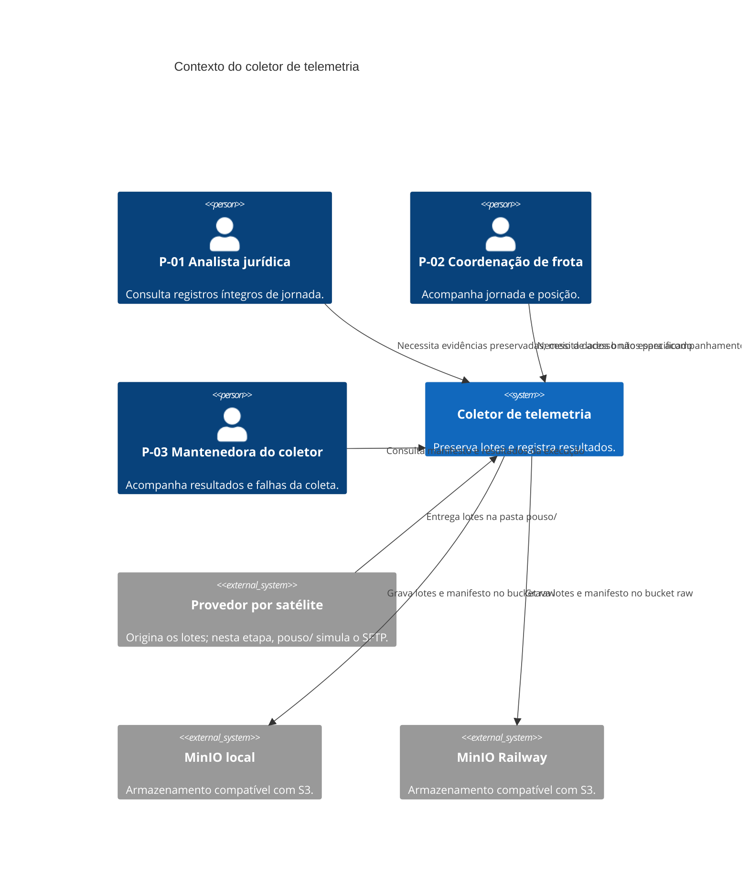
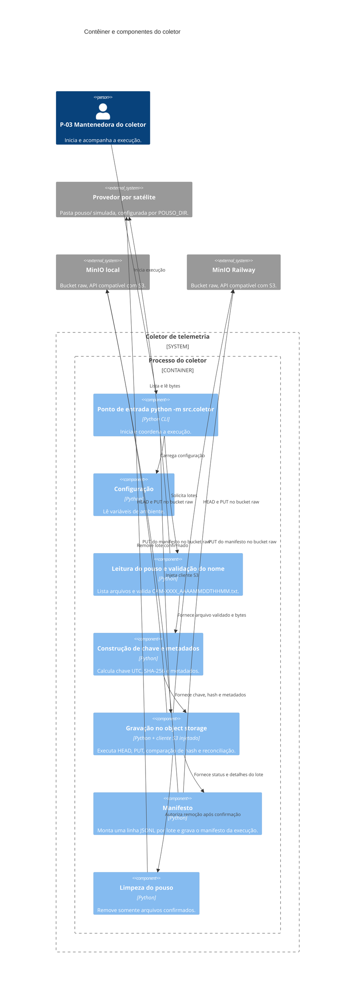

# Plano de arquitetura do coletor
## Contexto e decisões
- O coletor executa localmente, lê a pasta `pouso/` simulada e grava lotes e manifesto no bucket `raw`, em MinIO local ou Railway conforme as variáveis de ambiente (RF-01, RF-09, RNF-04, RNF-06).
- O jurídico (P-01) consulta evidências preservadas; a coordenação de frota (P-02) acompanha jornada e posição. O coletor suporta essas necessidades preservando os lotes, sem parser ou painel (RF-04, RF-08).
- O provedor por satélite é representado pela pasta `pouso/`, que faz o papel do SFTP; não há conexão com SFTP real (RF-01). A mantenedora (P-03) obtém visibilidade pelo manifesto e resultados por lote (RF-09, RF-10, RF-11).
## Diagrama C4 de contexto


## Diagrama C4 de contêineres e componentes


Os nomes dos módulos correspondem aos componentes do diagrama. O ponto de entrada Python `python -m src.coletor` atende à execução da coleta (RF-01, RF-09). O componente **Gravação no object storage** recebe o cliente S3 por parâmetro (injeção de dependência), permitindo substituir o armazenamento por um falso em memória nos testes (RF-05 a RF-09).

## Diagrama de sequência de uma execução
```mermaid
sequenceDiagram
    actor Operador as P-03 Mantenedora
    participant CLI as Ponto de entrada python -m src.coletor
    participant Leitura as Leitura do pouso e validação do nome
    participant Chave as Construção de chave e metadados
    participant Gravacao as Gravação no object storage
    participant MinIO as MinIO (bucket raw)
    participant Limpeza as Limpeza do pouso
    participant Manifesto as Manifesto
    Operador->>CLI: inicia execução e carrega configuração
    CLI->>Leitura: lista arquivos em POUSO_DIR
    loop para cada lote
        Leitura->>Leitura: lê bytes e valida nome
        alt nome inválido ou leitura falha
            Leitura->>Manifesto: status erro; chave null quando inválida
        else lote legível e nome válido
            Leitura->>Chave: bytes e nome validado
            Chave->>Chave: calcula sha256, chave UTC e metadados
            Chave->>Gravacao: chave, hash, metadados e bytes
            Gravacao->>MinIO: HEAD da chave
            alt chave não existe
                Gravacao->>MinIO: PUT do lote com metadados
                alt PUT confirmado
                    Gravacao->>Manifesto: status gravado
                    Gravacao->>Limpeza: autoriza remoção
                    Limpeza->>Leitura: remove arquivo do pouso
                else PUT ambíguo (502 ou timeout)
                    Note over Gravacao,MinIO: 502 não prova falha; HEAD antes de qualquer repetição do PUT
                    Gravacao->>MinIO: HEAD de reconciliação
                    alt ausente confirmado
                        alt novo PUT confirmado
                            Gravacao->>MinIO: novo PUT após espera crescente
                            Gravacao->>Manifesto: status gravado
                            Gravacao->>Limpeza: autoriza remoção
                            Limpeza->>Leitura: remove arquivo do pouso
                        else novo PUT falhou
                            Gravacao->>Manifesto: status erro; arquivo permanece no pouso (RF-07)
                        end
                    else hash igual
                        Gravacao->>Manifesto: status ja_existia
                        Gravacao->>Limpeza: autoriza remoção
                        Limpeza->>Leitura: remove arquivo do pouso
                    else hash diferente ou HEAD inconclusivo
                        Gravacao->>Manifesto: conflito_hash ou erro
                    end
                end
            else chave existe
                Gravacao->>MinIO: obtém hash do objeto via HEAD/metadado
                alt sha256 igual
                    Gravacao->>Manifesto: status ja_existia
                    Gravacao->>Limpeza: autoriza remoção
                    Limpeza->>Leitura: remove arquivo do pouso
                else sha256 diferente
                    Gravacao->>Manifesto: status conflito_hash
                end
            end
        end
    end
    CLI->>Manifesto: fecha JSONL com uma linha por lote
    Manifesto->>MinIO: PUT do manifesto em _manifestos/telemetria/...
```

Em hash diferente, erro ou confirmação inconclusiva, o arquivo permanece no pouso (RF-06, RF-07). Falha em um lote não encerra o processamento dos demais (RF-10). O manifesto é enviado ao final da execução (RF-09).
## Configuração do cliente S3
- `endpoint_url` vem de `S3_ENDPOINT_URL`; usar `addressing_style=path`; credenciais, região e bucket vêm de `S3_ACCESS_KEY`, `S3_SECRET_KEY`, `S3_REGION` e `BUCKET_RAW` (RNF-04, RNF-05, RNF-06).
- Cliente injetado na **Gravação no object storage**; operações usam a API compatível com S3 (RNF-04, RNF-06).
- Para PUT, uma chamada do SDK não deve fazer retry automático: após resposta ambígua, a **Gravação no object storage** consulta HEAD antes de decidir sobre novo PUT (RNF-01, RNF-03).
- Falhas transitórias usam espera crescente sob controle do coletor; HTTP 403 não é repetido. Política automática não pode contornar as regras para PUT (RNF-01 a RNF-03). Número de tentativas, esperas e timeout: hipótese, validação pendente.
## Escolhas técnicas
| Escolha | Alternativa considerada | Justificativa |
|---|---|---|
| Cliente `boto3`/botocore configurado para API S3 | SDK MinIO | RNF-04 e RNF-06 exigem endpoint configurável e API compatível com S3; o cliente é injetado para teste. |
| Um objeto por lote, bytes originais | Concatenar os quatro lotes da hora | RF-04 exige preservar os bytes de cada arquivo; RF-05 e RF-06 comparam hash por chave e retransmissão. Concatenar altera conteúdo e identidade do lote. |
| Particionar pela janela de início convertida para UTC | Hora de chegada ou horário de Brasília | RF-03 exige chave determinística baseada no início da janela em UTC; chegada varia por execução e partição em Brasília não atende ao formato UTC. |
| Apagar do pouso após confirmação de gravação ou `ja_existia` idêntico | Mover para `pouso/processados` | RF-07 e RF-02 definem remoção somente após confirmação e permanência em falha; mover introduziria um estado e comportamento não especificados. |
| Manifesto JSONL enviado ao fim da execução | Apenas logs transitórios | RF-09 exige manifesto durável com uma linha por lote e caminho UTC. |
| Cliente de armazenamento injetado no gravador | Cliente criado diretamente dentro do gravador | RF-05 a RF-09 exigem testes substituíveis e verificáveis sem depender do MinIO real. |

Todas as escolhas acima apontam para RF/RNF; nenhuma tecnologia adicional é assumida sem requisito correspondente.
## Estratégia de testes
- **Unitários com pytest:** cobrir validação, conversão UTC, chave, hash, alertas, idempotência e retry/reconciliação (RF-02 a RF-06, RF-09, RNF-01 a RNF-03). Usar `tmp_path` como `POUSO_DIR` e armazenamento falso em memória com a mesma interface injetada na **Gravação no object storage** (RF-05 a RF-10).
- **Integração:** marcar os testes com `@pytest.mark.integracao`; executá-los somente quando o MinIO local estiver no ar (RNF-06).
- Preparar entrada com `python gerar_lotes.py --inicio 2026-10-17T09:00`; confirmar 80 objetos, metadados, manifesto, remoção apenas após confirmação e segunda execução como `ja_existia` (RF-04 a RF-09). O gerador e os lotes versionados não devem ser editados.
## Riscos técnicos iniciais
- Um PUT pode ter sido confirmado apesar de 502 ou timeout; repetir sem HEAD pode sobrescrever conteúdo distinto (RF-03, RF-06). Sem timeout ou limite de tentativas acordados, duração e recuperação permanecem indefinidas; hipótese, validação pendente (RNF-01, RNF-03).
- Se a chave existir sem metadado `sha256` utilizável, a decisão de idempotência não está definida no spec e precisa ser validada (RF-05, RF-06).
- Falha no PUT do manifesto pode ocorrer após remoção dos lotes; recuperação do manifesto é lacuna. A decisão de quando remover o arquivo do pouso em relação ao PUT do manifesto permanece pendente. Validação de formato não é prova independente: a evidência depende de hash e metadados (RF-04, RF-07 a RF-09).
