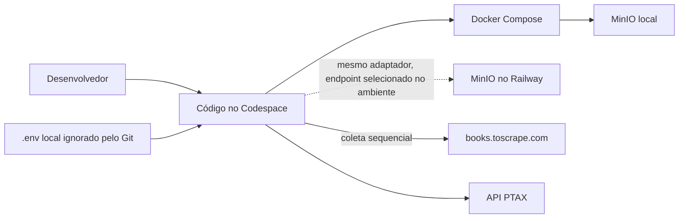

# Arquitetura do monitor de preços

> Esta visão e os ADRs relacionados têm status **Proposta**. A aceitação
> das decisões cabe ao grupo.

## Drivers arquiteturais

| Driver | Necessidade | Consequência arquitetural |
|---|---|---|
| DN-01 · Comparação diária sem referência de preço e câmbio | P1 precisa comparar preços observados com uma cotação PTAX elegível e identificável. | Coletar o catálogo e a janela PTAX para uma data de referência comum; preservar os dados que sustentam o snapshot. |
| DN-02 · Falhas de coleta sem diagnóstico oportuno | P2 precisa localizar ausência, falha HTTP, falha de armazenamento ou divergência. | Registrar itens, tentativas, hashes, totais e erros em manifesto por execução. |
| DN-03 · Bronze difícil de consumir na Aula 04 | P3 precisa receber JSON Lines consistente e rastreável. | Separar bytes brutos da extração e publicar apenas contratos bronze definidos. |
| RNF-01 · Correção e completude | Extração deve preservar origem e detectar divergência em relação ao total declarado. | Parser determinístico, validação de contratos e comparação antes da publicação. |
| RNF-03 · Eficiência e educação na coleta | Evitar paralelismo contra o site e respeitar intervalo mínimo configurado. | Coleta sequencial com limitação centralizada no cliente HTTP. |
| RNF-05 · Diagnóstico | Falhas ou ausência devem ficar visíveis. | Manifesto da execução e estado por item. |
| RNF-06 · Confiabilidade | Falhas transitórias podem ser tentadas novamente sem retry infinito. | Timeout, classificação de erro, backoff com full jitter, `Retry-After` e limite configurado. |
| RNF-07 · Reexecução | Atualizar o resultado diário sem duplicar nem sobrescrever o histórico bruto. | Endereços raw determinísticos e imutáveis, manifesto novo por execução e substituição controlada do bronze diário. |
| RNF-09 · Manutenibilidade | Extração deve poder ser testada sem rede de origem. | Extrator consome somente objetos raw armazenados. |
| RNF-10 · Portabilidade | O mesmo código deve operar contra MinIO local e MinIO no Railway. | Adaptador de armazenamento único e destino selecionado por configuração. |

RNF-02 (timeout explícito), RNF-04 (metadados ASCII) e RNF-08 (segredos fora do Git) são restrições transversais importantes, tratadas no cliente HTTP, no adaptador e na configuração.

## Estilo arquitetural

**Pipeline em lotes com etapas separadas**, coordenado para uma data de referência:

1. **Configuração e início:** validar ambiente, selecionar categorias e destino, determinar a data em `America/Sao_Paulo` e abrir manifesto.
2. **Coleta:** consultar `robots.txt`, páginas e detalhes Books, e consultar a janela GBP na PTAX. As respostas são preservadas antes da interpretação.
3. **Extração:** ler apenas os objetos raw relacionados no manifesto, decodificar e validar HTML/JSON, formar `Livro` e `Cotacao`.
4. **Validação e publicação:** comparar totais, registrar estado e publicar os JSONL diários quando as validações aplicáveis forem concluídas.

As etapas são separadas por contratos persistidos, não por chamadas diretas do extrator às fontes. A coleta permanece sequencial no site. A tradução cambial para reais, silver/gold, Parquet, DuckDB, agendamento de produção e painéis estão fora do escopo desta etapa.

## Visão de implantação

O fluxo normal de desenvolvimento usa Codespace, Docker Compose e MinIO local. O destino remoto MinIO no Railway é uma alternativa de implantação; o endpoint e as credenciais vêm do ambiente e não são incorporados ao código nem ao Git. A capacidade de 1 GB de RAM no Railway trial orienta uma execução simples, sem paralelismo ou componentes extras de processamento. `raw` mantém bytes de origem, e `bronze` mantém os JSON Lines correntes.

## Tática → atributo de qualidade → RNF

| Tática | Atributo de qualidade | RNF relacionado |
|---|---|---|
| Separar coleta e extração por objetos raw persistidos | Manutenibilidade, testabilidade | RNF-09, RNF-01 |
| Usar chaves raw determinísticas por fonte, data, recurso e hash do corpo | Confiabilidade, reexecução e integridade | RNF-07 |
| Aplicar timeout explícito e retry limitado com backoff, full jitter e `Retry-After` | Confiabilidade, tolerância a falhas | RNF-02, RNF-06 |
| Consultar o site sequencialmente com intervalo mínimo configurado | Compatibilidade com a fonte, uso responsável, desempenho previsível | RNF-03 |
| Preservar bytes originais e decodificar somente no parser | Integridade, auditabilidade, compatibilidade | RNF-01, RNF-07, RNF-09 |
| Registrar manifesto por execução e estado por item | Observabilidade, auditabilidade | RNF-05, RNF-07 |
| Consultar PTAX por janela de datas e escolher fechamento elegível | Adequação funcional, correção temporal | RNF-01 |
| Validar metadados ASCII e injetar destino MinIO por configuração | Portabilidade, compatibilidade | RNF-04, RNF-10 |
| Manter credenciais em `.env` ignorado pelo Git | Confidencialidade | RNF-08 |

## Trade-offs e riscos

| Escolha | Benefício | Trade-off ou risco |
|---|---|---|
| Coleta e extração separadas | Reprocessamento offline e possibilidade de corrigir parser sem refazer scraping. | Exige armazenar, localizar e manter os brutos e os manifestos. |
| Raw imutável e endereçado por hash | Permite auditoria e evita sobrescrita acidental; respostas iguais podem ser reutilizadas. | Conteúdo diferente gera novos objetos e aumenta consumo do armazenamento, especialmente no trial do Railway. |
| Retry de falha transitória | Recupera instabilidades sem intervenção manual imediata. | Aumenta a duração e o número de chamadas; limite e tempos ainda têm valores marcados como hipótese nos RNFs. |
| Uma requisição por vez e intervalo | Reduz carga simultânea sobre o site e respeita as restrições da disciplina. | A coleta completa leva mais tempo; o intervalo mínimo de aceite ainda depende de validação. |
| Janela PTAX | Captura fechamento de dia útil anterior em fins de semana/feriados e expõe a data efetiva. | A janela precisa ser dimensionada; se não trouxer fechamento elegível, o ciclo fica incompleto em vez de inventar valor. |
| Manifesto por execução | Permite distinguir tentativas do dia, explicar falhas e preservar histórico. | Manifests também ocupam espaço e precisam evitar credenciais e mensagens sensíveis. |
| Mesmo adaptador para dois MinIO | Evita bifurcação de código. | Diferenças de rede, trial, permissões e metadados entre ambientes ainda exigem testes de integração. |

## Decisões propostas

- [ADR-001 · Coleta e extração separadas](./adr/ADR-001-coleta-e-extracao-separadas.md)
- [ADR-002 · Chaves determinísticas para objetos brutos](./adr/ADR-002-chaves-deterministicas-raw.md)
- [ADR-003 · Retry com backoff exponencial, full jitter e Retry-After](./adr/ADR-003-retry-backoff-full-jitter.md)
- [ADR-004 · Coleta sequencial com intervalo mínimo](./adr/ADR-004-coleta-sequencial-intervalo.md)
- [ADR-005 · Bytes originais no bruto e decodificação no parser](./adr/ADR-005-bytes-brutos-decodificacao-parser.md)
- [ADR-006 · Manifesto por execução](./adr/ADR-006-manifesto-por-execucao.md)
- [ADR-007 · Consulta PTAX por janela de dias](./adr/ADR-007-janela-de-dias-ptax.md)

## Referências da arquitetura

- Requisitos: [RFs](../specs/01_requisitos_funcionais.md), [RNFs](../specs/02_requisitos_nao_funcionais.md), [modelo de dados](../specs/03_modelo_de_dados.md).
- Drivers: [objetivos de negócio](./01_objetivos_negocio.md), [regras de negócio](./02_regras_de_negocio.md).
- Visão estática: [componentes](./componentes.md), [classes](./classes.md).
- Etapa 08, fluxos dinâmicos: [coleta PTAX](./modelagem/dinamica/coleta_ptax.md), [coleta Books](./modelagem/dinamica/coleta_books.md), [gravação raw](./modelagem/dinamica/gravacao_raw.md), [extração](./modelagem/dinamica/extracao.md), [reexecução](./modelagem/dinamica/reexecucao.md), [estados do item](./modelagem/dinamica/estados_item.md).
