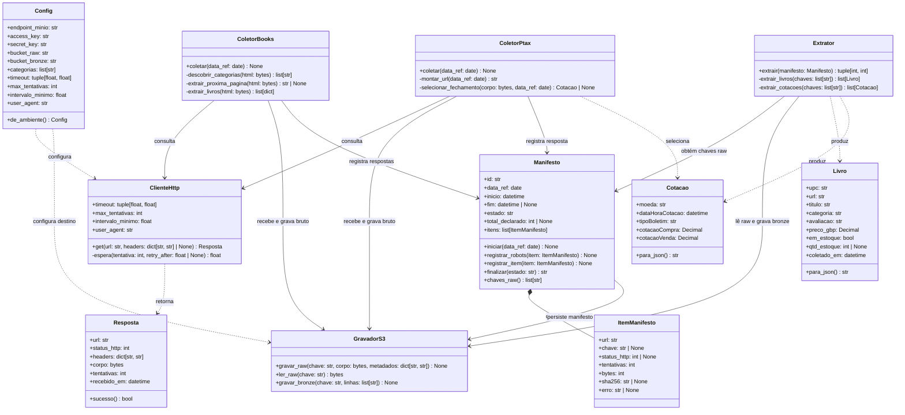

# Arquitetura de classes · Monitor de preços

Os nomes das classes correspondem aos módulos previstos em `src/`. Assinaturas descrevem interfaces de projeto; não há implementação nesta etapa. `data_ref` fica no manifesto e nas chaves, não é campo extra dos JSONL.

## Dependências e limites

- `ColetorBooks` e `ColetorPtax` recebem `ClienteHttp`, `GravadorS3` e `Manifesto` por injeção; não inicializam nem importam o cliente MinIO.
- `Extrator` depende de `Manifesto` para localizar os brutos e de `GravadorS3` para lê-los e publicar JSONL. Não importa `requests`, `ClienteHttp` ou qualquer cliente de rede externa.
- `GravadorS3` recebe endpoint e credenciais via `Config`; os mesmos métodos servem MinIO local e Railway, com troca apenas da configuração.
- `ItemManifesto` registra cada tentativa final por recurso. `Manifesto` mantém totais e estado da execução e referencia chaves raw sem incorporar o ID da execução nessas chaves.
- `Livro.para_json()` emite exatamente os nove campos do contrato de livros. `Cotacao.para_json()` emite exatamente os cinco campos do contrato PTAX.
