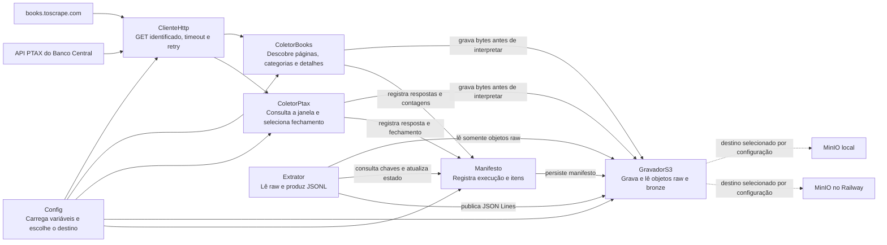

# Arquitetura de componentes · Monitor de preços

## Diagrama

MinIO local e MinIO no Railway são destinos alternativos do mesmo adaptador, não destinos gravados simultaneamente. Os coletores recebem `GravadorS3` por dependência e não conhecem o MinIO nem o SDK de armazenamento. `Extrator` recebe somente o adaptador de armazenamento e o manifesto; não depende do cliente HTTP nem de `requests`.

## Responsabilidades e rastreabilidade

| Componente | Responsabilidade | Interface pública prevista em `src/` | RF | RNF |
|---|---|---|---|---|
| Books to Scrape | Fonte de páginas de categorias, listagens e detalhes | HTTP GET | RF-01, RF-02, RF-04, RF-05, RF-06 | RNF-03 |
| API PTAX | Fonte de boletins de câmbio | HTTP GET com período e moeda | RF-07, RF-08, RF-16 | RNF-02, RNF-06 |
| Config | Validar ambiente e prover parâmetros, segredos e seleção do destino | `Config.de_ambiente()` | RF-03, RF-06, RF-07, RF-16 | RNF-02, RNF-03, RNF-06, RNF-08, RNF-10 |
| ClienteHttp | Fazer requisições identificadas com timeout, intervalo e retry limitado | `ClienteHttp.get()` | RF-05, RF-06, RF-07, RF-16 | RNF-02, RNF-03, RNF-06 |
| ColetorBooks | Consultar robots.txt, descobrir categorias e páginas, preservar listagens e detalhes, contabilizar itens | `ColetorBooks.coletar()` | RF-01, RF-02, RF-03, RF-04, RF-05, RF-06, RF-09, RF-14 | RNF-01, RNF-03, RNF-05 |
| ColetorPtax | Montar janela PTAX, preservar resposta e determinar se há fechamento elegível | `ColetorPtax.coletar()` | RF-07, RF-08, RF-10, RF-16 | RNF-02, RNF-05, RNF-06 |
| GravadorS3 | Abstrair leitura e gravação de bytes no MinIO, incluindo metadados ASCII | `GravadorS3.gravar_raw()`, `ler_raw()`, `gravar_bronze()` | RF-09, RF-10, RF-11, RF-12, RF-13, RF-15 | RNF-04, RNF-07, RNF-08, RNF-09, RNF-10 |
| Manifesto | Manter estado, totais, itens, hashes e erros por execução e persistir seu registro | `Manifesto.iniciar()`, `registrar_item()`, `finalizar()` | RF-05, RF-08, RF-09, RF-10, RF-13, RF-14, RF-15 | RNF-05, RNF-07, RNF-08, RNF-10 |
| Extrator | Ler objetos brutos associados ao manifesto, criar registros e publicar os dois JSONL | `Extrator.extrair()` | RF-11, RF-12, RF-13, RF-14, RF-15 | RNF-01, RNF-05, RNF-07, RNF-09, RNF-10 |
| MinIO local | Persistir objetos raw e bronze para desenvolvimento e testes integrados | API S3 usada pelo `GravadorS3` | RF-09, RF-10, RF-11, RF-12, RF-13, RF-15 | RNF-04, RNF-07, RNF-10 |
| MinIO no Railway | Persistir os mesmos objetos no destino remoto, sem mudar o código | API S3 usada pelo `GravadorS3` | RF-09, RF-10, RF-11, RF-12, RF-13, RF-15 | RNF-04, RNF-07, RNF-10 |

`Resposta`, `Livro` e `Cotacao` são tipos de dados usados pelos componentes; seus contratos estão detalhados no diagrama de classes.
