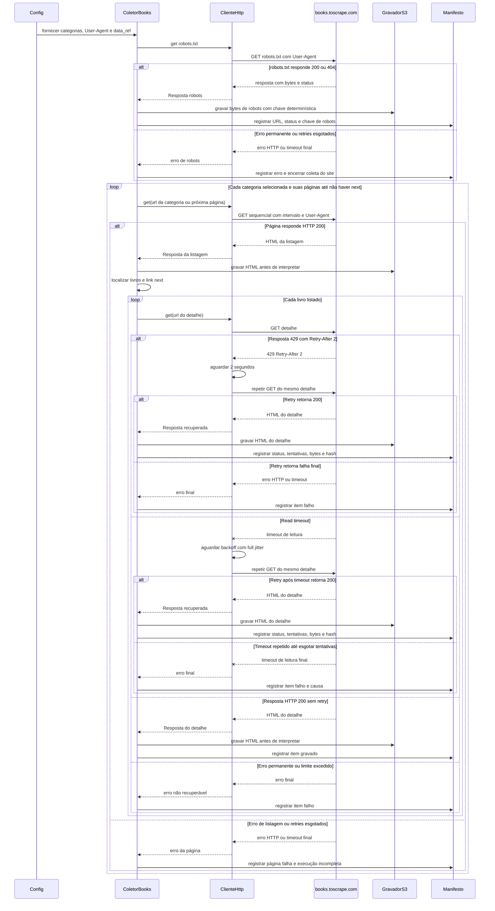

# Fluxo · Coleta de categoria, paginação e detalhes

## Diagrama de sequência

## Requisitos realizados

**RF:** RF-01, RF-02, RF-03, RF-04, RF-05, RF-06, RF-09, RF-13, RF-14.  
**RNF:** RNF-01, RNF-02, RNF-03, RNF-05, RNF-06.

| RNF | Como o fluxo o realiza |
|---|---|
| RNF-01 | Campos são extraídos da listagem e do detalhe da mesma observação; a contagem final é comparada ao total declarado e divergência fica visível. |
| RNF-02 | Cada GET usa timeout explícito de conexão e leitura. |
| RNF-03 | Uma requisição ao site fica ativa por vez e o intervalo configurado separa o início de cada chamada. |
| RNF-05 | Erro em robots, listagem ou detalhe é registrado no manifesto com estado e causa. |
| RNF-06 | 429 respeita `Retry-After`; read timeout é transitório e repetido com full jitter, até o limite configurado. Erros permanentes não são repetidos. |
