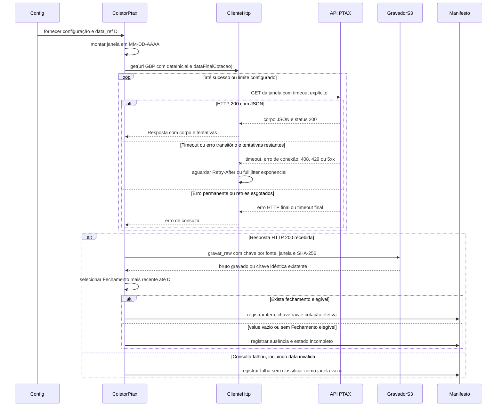

# Fluxo · Coleta da PTAX

## Diagrama de sequência

## Requisitos realizados

**RF:** RF-07, RF-08, RF-10, RF-13, RF-16.  
**RNF:** RNF-02, RNF-05, RNF-06.

| RNF | Como o fluxo o realiza |
|---|---|
| RNF-02 | `ClienteHttp` aplica timeout explícito de conexão e leitura à chamada PTAX. |
| RNF-05 | Janela vazia, falta de Fechamento e falha HTTP são registradas no manifesto como ausência ou falha, sem gerar cotação fictícia. |
| RNF-06 | Só falhas transitórias são repetidas, com limite configurado, backoff exponencial com full jitter e precedência de `Retry-After`. Erro permanente de formato não é tratado como janela vazia. |
