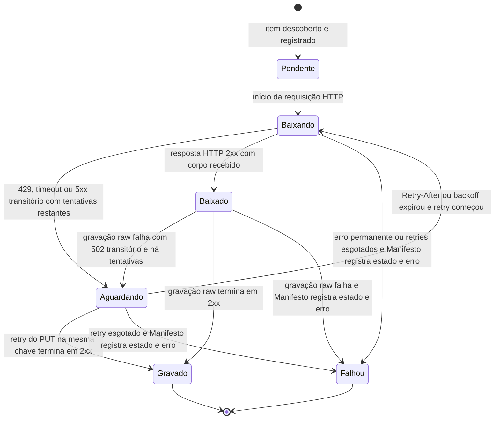

# Estados de um item do manifesto

## Diagrama de estados

## Transições e eventos

| Estado de origem | Estado de destino | Evento que causa a transição |
|---|---|---|
| Inicial | Pendente | Descoberta de URL/recurso e criação do item no manifesto |
| Pendente | Baixando | `ClienteHttp` inicia a primeira requisição |
| Baixando | Aguardando | HTTP 429, timeout de conexão/leitura ou 5xx transitório, com retries restantes |
| Aguardando | Baixando | Expira `Retry-After` ou backoff e `ClienteHttp` inicia nova tentativa |
| Baixando | Baixado | Resposta HTTP 2xx recebida com corpo |
| Baixando | Falhou | Erro permanente ou limite de retries atingido sem resposta aproveitável; `Manifesto` persiste estado `falhou` e causa |
| Baixado | Aguardando | PUT do raw recebe erro transitório 502 e ainda há retries |
| Baixado | Gravado | PUT do raw retorna sucesso |
| Aguardando | Gravado | Retry do PUT na mesma chave retorna sucesso |
| Baixado | Falhou | PUT falha permanentemente ou esgota retries; `Manifesto` persiste estado `falhou` e causa |
| Aguardando | Falhou | O limite de retries se esgota ao término da espera ou da próxima tentativa; `Manifesto` persiste estado `falhou` e causa |

`Falhou` é estado final: não há transições de saída, e o item permanece no manifesto com `estado: "falhou"` e a causa em `erro`. O manifesto também registra URL, chave quando houver corpo persistido, status HTTP final, quantidade de tentativas, bytes e SHA-256. Um item `Falhou` não referencia uma chave raw que não tenha sido confirmada como gravada.
