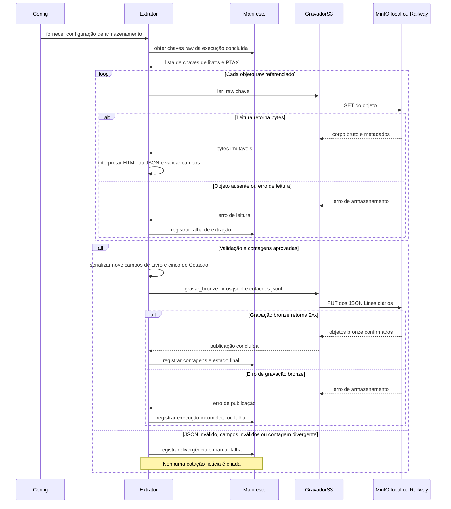

# Fluxo · Extração dos objetos MinIO para JSON Lines

## Diagrama de sequência

Não há participante nem chamada de rede externa neste fluxo. O Extrator lê somente os objetos brutos pelo `GravadorS3`, valida e então publica os JSONL diários.

## Requisitos realizados

**RF:** RF-11, RF-12, RF-13, RF-14.  
**RNF:** RNF-01, RNF-04, RNF-05, RNF-07, RNF-09, RNF-10.

| RNF | Como o fluxo o realiza |
|---|---|
| RNF-01 | A extração valida os campos contratuais e compara o total extraído ao declarado antes de publicar. |
| RNF-04 | Metadados dos brutos são consumidos sem alteração e os objetos gerados seguem o mesmo contrato de armazenamento. |
| RNF-05 | Erros de leitura, dados inválidos e divergências são associados à execução no manifesto. |
| RNF-07 | Resultados bronze são publicados nos endereços diários correntes sem duplicar linhas por reexecução. |
| RNF-09 | A extração usa apenas chaves e bytes já persistidos no MinIO, sem requests ou qualquer rede de origem. |
| RNF-10 | `GravadorS3` aplica a mesma interface de leitura e gravação aos destinos local e Railway. |
