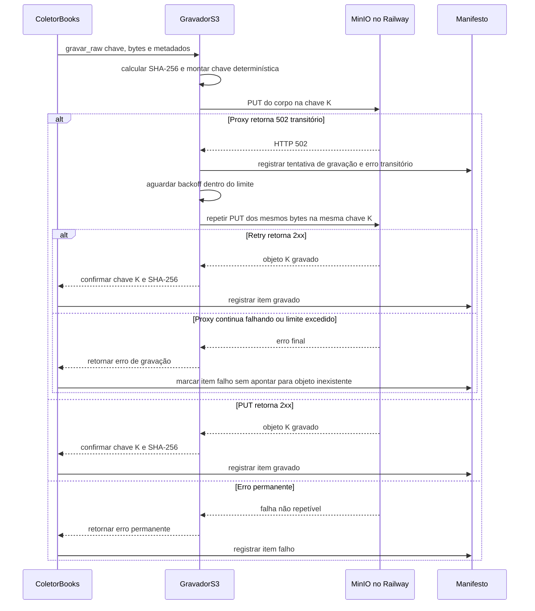

# Fluxo · Gravação de objeto raw com falha do proxy

## Diagrama de sequência

## Requisitos realizados

**RF:** RF-09, RF-10, RF-13.  
**RNF:** RNF-04, RNF-05, RNF-06, RNF-07, RNF-10.

| RNF | Como o fluxo o realiza |
|---|---|
| RNF-04 | Metadados ASCII são validados antes do PUT; o mesmo formato é usado no destino local e Railway. |
| RNF-05 | Cada tentativa e o erro final são registrados no manifesto, sem marcar como gravado um objeto que falhou. |
| RNF-06 | O 502 transitório recebe retry limitado e espera com backoff. Cada retry usa os mesmos bytes e a mesma chave K. |
| RNF-07 | A chave derivada da fonte, data, recurso e hash não incorpora ID de execução; retry não cria outra chave nem altera conteúdo. |
| RNF-10 | O adaptador mantém o mesmo contrato para MinIO local e Railway; apenas o endpoint configurado muda. |
