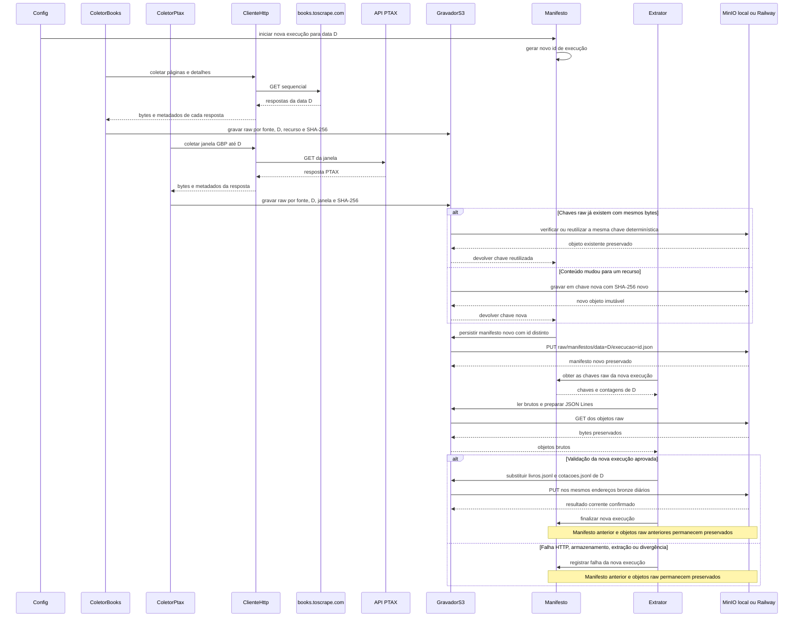

# Fluxo · Reexecução no mesmo dia

## Diagrama de sequência

## Requisitos realizados

**RF:** RF-09, RF-10, RF-13, RF-14, RF-15.  
**RNF:** RNF-04, RNF-05, RNF-06, RNF-07, RNF-08, RNF-10.

| RNF | Como o fluxo o realiza |
|---|---|
| RNF-04 | A mesma validação de metadados e o mesmo contrato de armazenamento valem no destino configurado. |
| RNF-05 | Uma falha da nova execução é registrada sem encobrir o estado ou manifesto de execuções anteriores. |
| RNF-06 | Falhas transitórias de coleta ou armazenamento usam retry limitado; erros permanentes são registrados. |
| RNF-07 | Cada reexecução recebe novo manifesto, reutiliza chave raw quando conteúdo e recurso coincidem, mantém brutos imutáveis e substitui apenas os JSONL diários correntes após validação. |
| RNF-08 | Credenciais usadas para acessar MinIO são fornecidas pela configuração local ignorada pelo Git e não aparecem no manifesto. |
| RNF-10 | Trocar MinIO local por Railway requer apenas alterar a configuração do destino, sem mudar os fluxos. |

## Matriz final · Fluxo | RF | RNF

| Fluxo | RF | RNF |
|---|---|---|
| Coleta PTAX | RF-07, RF-08, RF-10, RF-13, RF-16 | RNF-02, RNF-05, RNF-06 |
| Coleta Books | RF-01, RF-02, RF-03, RF-04, RF-05, RF-06, RF-09, RF-13, RF-14 | RNF-01, RNF-02, RNF-03, RNF-05, RNF-06 |
| Gravação raw | RF-09, RF-10, RF-13 | RNF-04, RNF-05, RNF-06, RNF-07, RNF-10 |
| Extração | RF-11, RF-12, RF-13, RF-14 | RNF-01, RNF-04, RNF-05, RNF-07, RNF-09, RNF-10 |
| Reexecução | RF-09, RF-10, RF-13, RF-14, RF-15 | RNF-04, RNF-05, RNF-06, RNF-07, RNF-08, RNF-10 |
