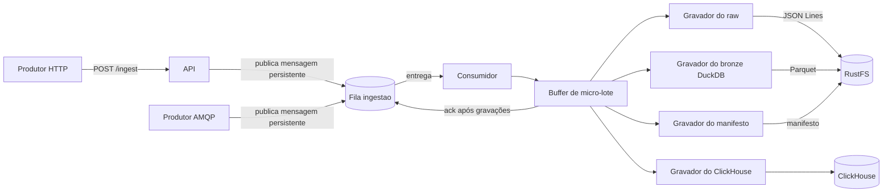
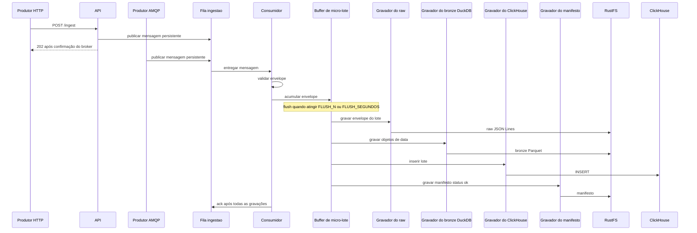
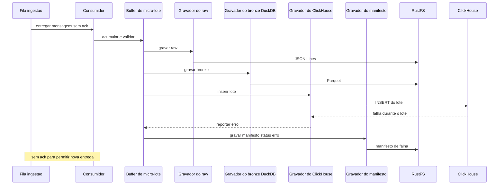

# Arquitetura da ingestão

## Componentes

HTTP publica pela API; o produtor AMQP publica na fila. O consumidor valida mensagens e acumula envelopes no buffer. No flush, os gravadores persistem raw, bronze, ClickHouse e manifesto nessa ordem. O consumidor confirma as mensagens após as gravações.

## Sequência: caminho feliz

## Sequência: falha do ClickHouse no meio do lote

## Decisões registradas

| Decisão | ADR | Requisitos relacionados |
|---|---|---|
| API HTTP publica na fila | ADR-001 | RF-01, RF-02, RF-03 |
| Persistir raw e bronze antes do ClickHouse | ADR-002 | RF-06, RF-07, RF-08, RNF-04 |
| Manifesto depois do ClickHouse e ack só após tudo gravado | ADR-003 | RF-09, RF-10, RF-11, RNF-02 |
| Buffer com flush por tamanho ou tempo | ADR-004 | RF-06 a RF-10, RNF-01 |
| Tabela comum de três colunas com `data_json JSON` | ADR-005 | RF-07, RF-08, RNF-03, RNF-04 |
