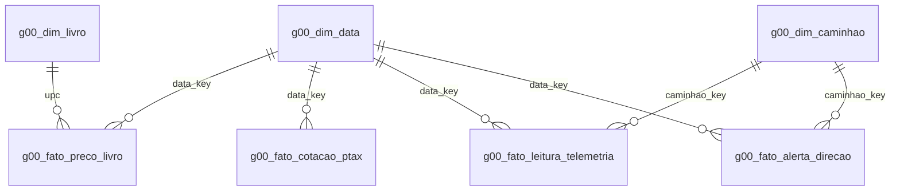

# Modelo dimensional — Kimball

## Convenção e data

- Prefixo obrigatório dos objetos: `g00_`.
- `g00_dim_data.data_key` é inteiro gerado no formato `AAAAMMDD`.
- A origem é `mackenzie.db_ingestion`; somente consultas `SELECT` foram usadas.
- Os fatos são separados porque posição e alerta têm chaves e grãos diferentes.

## Fatos e grãos

| Processo | Fato | Grão: uma linha é | Chave do grão | Dimensões | Medidas |
|---|---|---|---|---|---|
| Preço diário de livros | `g00_fato_preco_livro` | uma observação de um livro em uma data de coleta | `data_key, upc` | data, livro | `preco_gbp`, `qtd_estoque`, `avaliacao`, `em_estoque` |
| Cotação PTAX | `g00_fato_cotacao_ptax` | uma cotação de uma moeda em uma data, hora e tipo de boletim | `data_key, moeda, data_hora_cotacao, tipo_boletim` | data | `cotacao_compra`, `cotacao_venda`, `paridade_compra`, `paridade_venda` |
| Leitura de posição | `g00_fato_leitura_telemetria` | uma leitura válida de posição de um caminhão em um instante | `data_key, caminhao_id, instante_leitura` | data, caminhão | `latitude`, `longitude`, `velocidade_kmh`, `tachometro_codigo` |
| Alerta de direção | `g00_fato_alerta_direcao` | um alerta de direção contínua de um caminhão em um instante | `data_key, caminhao_id, instante_alerta, duracao_continua_min` | data, caminhão | `quantidade_alerta`, `duracao_continua_min` |

`tipo_boletim` é dimensão degenerada e permanece apenas no fato PTAX.
Linhas `ERR SAT` e `#RADIO` não são fatos e são descartadas.

## Medidas e agregações

| Fato | Medida | Aditividade | Agregação válida |
|---|---|---|---|
| Preço livro | `preco_gbp` | Não aditiva | Média, mínimo, máximo ou último valor |
| Preço livro | `qtd_estoque` | Semiaditiva | Último valor ao longo da data; média por conjunto simultâneo |
| Preço livro | `avaliacao` | Não aditiva | Média, mínimo, máximo ou último valor |
| Preço livro | `em_estoque` | Não aditiva | Último valor ou contagem de `true` |
| Cotação PTAX | `cotacao_compra` | Não aditiva | Último valor, média, mínimo ou máximo |
| Cotação PTAX | `cotacao_venda` | Não aditiva | Último valor, média, mínimo ou máximo |
| Cotação PTAX | `paridade_compra` | Não aditiva | Último valor, média, mínimo ou máximo |
| Cotação PTAX | `paridade_venda` | Não aditiva | Último valor, média, mínimo ou máximo |
| Leitura telemetria | `latitude` | Não aditiva | Último valor, mínimo ou máximo |
| Leitura telemetria | `longitude` | Não aditiva | Último valor, mínimo ou máximo |
| Leitura telemetria | `velocidade_kmh` | Não aditiva | Média, mínimo, máximo ou último valor |
| Leitura telemetria | `tachometro_codigo` | Não aditiva | Último valor |
| Alerta direção | `quantidade_alerta` | Aditiva | Soma |
| Alerta direção | `duracao_continua_min` | Semiaditiva | Último valor por evento; soma apenas entre eventos não simultâneos |

## Dimensões

| Dimensão | Grão: uma linha é | SCD | Chave |
|---|---|---|---|
| `g00_dim_data` | um dia de calendário | Gerada; tipo 1 | `data_key = AAAAMMDD` |
| `g00_dim_livro` | uma versão de atributos de um livro | SCD tipo 2 pela versão do UPC | `livro_key` |
| `g00_dim_caminhao` | um caminhão | SCD tipo 1 | `caminhao_key`, natural `caminhao_id` |

## Testes do grão

Os testes abaixo usam `FINAL` nas tabelas de fato derivadas.

```sql
SELECT count() = uniqExact(tuple(data_key, upc))
FROM g00_fato_preco_livro FINAL;
```

```sql
SELECT count() = uniqExact(tuple(data_key, moeda, data_hora_cotacao, tipo_boletim))
FROM g00_fato_cotacao_ptax FINAL;
```

```sql
SELECT count() = uniqExact(tuple(data_key, caminhao_id, instante_leitura))
FROM g00_fato_leitura_telemetria FINAL;
```

```sql
SELECT count() = uniqExact(tuple(data_key, caminhao_id, instante_alerta, duracao_continua_min))
FROM g00_fato_alerta_direcao FINAL;
```

## Diagrama da estrela



## Matriz de barramento

| Fato | `g00_dim_data` | `g00_dim_livro` | `g00_dim_caminhao` |
|---|---|---|---|
| `g00_fato_preco_livro` | `data_key` tipo comum | `upc` / `livro_key` tipo compartilhável | — |
| `g00_fato_cotacao_ptax` | `data_key` tipo comum | — | — |
| `g00_fato_leitura_telemetria` | `data_key` tipo comum | — | `caminhao_id` / `caminhao_key` tipo compartilhável |
| `g00_fato_alerta_direcao` | `data_key` tipo comum | — | `caminhao_id` / `caminhao_key` tipo compartilhável |
