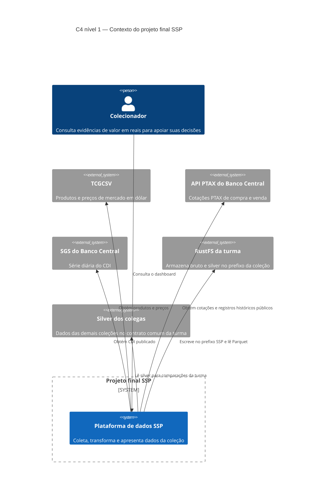
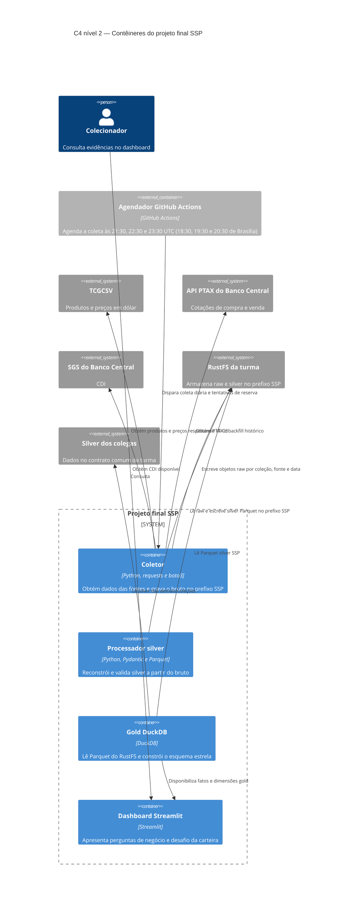

# Plano de arquitetura — projeto final SSP

## Escopo e premissas

Este plano descreve a arquitetura pretendida para a coleção SSP (`groupId 23651`). Ele não declara componentes ou requisitos como implementados. A ordem dos ADRs preserva a decisão do `AGENTS.md`: ADR-001 fica reservado para registrar a origem do código já existente em `src/collector.py` e `src/silver.py`; as novas decisões começam em ADR-002.

Decisões já tomadas pelo aluno e refletidas aqui:

- Agendador no GitHub Actions, com execuções às 21:30, 22:30 e 23:30 UTC (18:30, 19:30 e 20:30 de Brasília), conforme o workflow existente `coleta-diaria.yml` e ADR-008. O coletor é idempotente e recusa gravar preço do TCGCSV e fechamento da PTAX antes das 18h de Brasília; a configuração permite no máximo nove chamadas ao TCGCSV por dia, abaixo do limite de 10.000.
- Coletor e transformação silver em Python, usando `requests`, `boto3`, Pydantic e Parquet.
- Gold em DuckDB, lendo arquivos Parquet do RustFS.
- Dashboard em Streamlit.
- Credenciais no `.env` local e em GitHub Secrets; nenhum segredo em arquivo versionado.
- Classificação carta/selado derivada dos dados da fonte. Code Card é classificado como carta e fica excluído das perguntas 1, 3 e 4 conforme a regra de raridade definida pelo aluno.
- Backfill da PTAX permitido por se tratar de registro público organizado por data; o bruto continua imutável e o backfill não sobrescreve objetos existentes.

Os elementos nomeados nos diagramas são: Colecionador, Projeto final SSP, Plataforma de dados SSP, Agendador GitHub Actions, Coletor, Processador silver, Gold DuckDB, Dashboard Streamlit, TCGCSV, API PTAX do Banco Central, SGS do Banco Central, RustFS da turma e Silver dos colegas. Os mesmos nomes são usados nas seções de arquitetura e fluxo abaixo.

As execuções agendadas ocorrem após a atualização esperada do TCGCSV por volta das 17h de Brasília (cerca de 20h UTC, conforme RES-01). As tentativas de reserva não alteram a regra de lacuna declarada quando a coleta não obtiver dados.

## C4 nível 1 — Contexto

## C4 nível 2 — Contêineres

A chave da gold e seu local persistente não estão definidos na spec nem nas decisões recebidas. O diagrama representa Gold DuckDB como o contêiner que constrói e disponibiliza a gold; o modo de persistência fica como pergunta aberta, sem introduzir outro serviço ou banco.

## Fluxo de dados e responsabilidades de escrita

| Etapa | Entrada | Operação | Quem escreve | Destino e regra |
|---|---|---|---|---|
| Coleta | TCGCSV, API PTAX do Banco Central e SGS do Banco Central | Coleta produtos e preços diariamente; obtém PTAX e CDI disponíveis; permite backfill histórico público da PTAX. | Coletor | Escreve as respostas originais em raw no prefixo `group_id=23651`, identificadas por coleção, fonte e data. Verifica a existência da chave antes de gravar; não sobrescreve nem duplica. |
| Silver | Raw da coleção SSP | Valida o contrato comum; separa inválidos em quarentena com motivo e contagem no log; preserva nulos; deriva classificação carta/selado a partir da fonte. Code Card é carta e sua exclusão das perguntas 1, 3 e 4 segue a regra de raridade. | Processador silver | Lê raw e escreve silver Parquet somente no prefixo SSP no RustFS da turma. |
| Gold | Silver Parquet SSP e silver dos colegas | DuckDB lê os Parquets; converte preços pela última PTAX de fechamento até a data do preço; produz fatos e dimensões do esquema estrela e cálculos exigidos pela spec. | Gold DuckDB | Produz a gold para consumo pelo Dashboard Streamlit. Local e forma de persistência da gold ainda não definidos. |
| Apresentação | Gold e silver dos colegas no contrato comum, conforme a visualização | Apresenta as cinco perguntas em reais, identificadores, imagens e links disponíveis, filtros definidos e desafio da carteira. | Dashboard Streamlit | Leitura para apresentação; não escreve em prefixos de colegas. |

O Agendador GitHub Actions executa o workflow existente `coleta-diaria.yml` às 21:30, 22:30 e 23:30 UTC (18:30, 19:30 e 20:30 de Brasília). O coletor é idempotente e recusa gravar preço do TCGCSV e fechamento da PTAX antes das 18h de Brasília. O workflow permite no máximo nove chamadas ao TCGCSV por dia, abaixo do limite de 10.000; ADR-008 confirma esse estado. Falha ou ausência de dados é registrada como lacuna no README; não há preenchimento sintético.

A reconstrução de silver e gold deve continuar disponível por um único comando documentado no README (RF-06). O Agendador GitHub Actions agenda a coleta; silver e gold rodam pelo comando único de RF-06. Onde e quando esse comando será executado permanece pergunta aberta.

## Escolhas técnicas

| Escolha | Alternativas consideradas e motivo do descarte | Requisito ou restrição que justifica | ADR previsto |
|---|---|---|---|
| Chave de objeto raw por coleção, fonte e data, sem sobrescrita | Chave somente por data poderia colidir entre coleções ou fontes; sobrescrever o objeto do dia viola a imutabilidade. | RF-02, RNF-03, OBJ-07 e RES-02. | ADR-002 — chave por coleção e data (incluir fonte na identificação para separar origens). |
| Camadas raw, silver e gold reconstruíveis | Manter somente a última camada derivada impediria reconstrução; editar silver ou gold manualmente perderia a rastreabilidade a partir do bruto. | RF-02, RF-06, OBJ-07 e invariantes de `AGENTS.md`. | ADR-003 — camadas derivadas e reconstruíveis. |
| Gold em esquema estrela construída com DuckDB sobre Parquet do RustFS | pandas foi descartado porque o aluno escolheu DuckDB para consultas analíticas; banco relacional foi descartado porque exigiria escolher e operar outro banco, sem requisito correspondente. CSV foi descartado porque o aluno escolheu Parquet; JSON foi descartado pelo mesmo motivo. | RF-06, RF-07, RF-08 e RF-10 justificam reconstrução e modelo gold; DuckDB e Parquet: sem requisito correspondente específico. | ADR-004 — esquema estrela na gold. |
| Coletor e processador silver em Python com `requests`, `boto3`, Pydantic e Parquet | `httpx` e AWS CLI são alternativas a `requests` e `boto3`, respectivamente; o aluno escolheu as bibliotecas indicadas. Validação manual e validação somente com condicionais são alternativas a Pydantic; o aluno escolheu Pydantic. CSV e JSON são alternativas a Parquet; o aluno escolheu Parquet. Essas preferências não decorrem de requisito que torne as ferramentas obrigatórias. | RF-01, RF-03, RF-05 e RF-06; RES-01, RES-02 e RES-06. Python e as ferramentas específicas: sem requisito correspondente. | Sem ADR previsto além da decisão de camadas no ADR-003; escolhas específicas sem requisito correspondente. |
| Agendador no GitHub Actions, com execuções às 21:30, 22:30 e 23:30 UTC e tentativas de reserva | Execução manual foi descartada por não executar a coleta diária sem intervenção; agendador local foi descartado porque não oferece as execuções já configuradas no workflow `coleta-diaria.yml`. O workflow existente e seu estado são confirmados por ADR-008. | RF-01 e RF-03 justificam coleta diária e respeito à fonte; horários e produto GitHub Actions: sem requisito correspondente específico. | ADR-008 — agenda diária e tentativas de reserva. |
| Dashboard em Streamlit | Dash foi descartado em favor da escolha do aluno por Streamlit; Metabase foi descartado pela mesma decisão de ferramenta. Não há requisito que obrigue Streamlit. | RF-11 e RF-12 justificam dashboard e conteúdo; ferramenta Streamlit: sem requisito correspondente. RF-12 inclui a chave R$/US$. | Sem ADR previsto; tecnologia específica sem requisito correspondente. |
| Classificação carta/selado derivada da fonte; Code Card classificado como carta e excluído das perguntas 1, 3 e 4 segundo raridade | Classificação manual foi descartada porque não acompanha os dados da fonte; classificar Code Card como selado foi descartado por contrariar a decisão registrada. Os campos exatos usados para derivar a categoria ainda serão definidos no ADR. | RF-16; invariante de filtros e Code Card em `AGENTS.md`. O método e os campos da fonte não são determinados pelo requisito. | ADR-005 — classificação carta/selado e regra de Code Card. |
| Carteira própria com seleção usando apenas o primeiro dia | Selecionar com dias posteriores introduziria informação futura na composição; usar a cesta compartilhada da turma substituiria a decisão de carteira própria. | RF-13 e RF-14; OBJ-06 e invariante de carteira em `AGENTS.md`. | ADR-006 — regra da carteira própria, antes do primeiro cálculo. |
| Taxa de venda parametrizada; 15% tratado como hipótese | Fixar permanentemente 15% impede avaliar outros valores; assumir taxa zero omite custo de venda. A taxa exata permanece hipótese declarada em ADR. | RF-13, OBJ-06 e RES-05. | ADR-007 — taxa de venda como parâmetro e hipótese de 15%. |
| Credenciais em `.env` local e GitHub Secrets, nunca em arquivo versionado | Credencial embutida no código ou committada expõe acesso; variável sem proteção não atende à restrição de segredo fora do Git. | RNF-04 e RES-06; confirmação do aluno de que “variáveis do GitHub” significa GitHub Secrets. | Sem ADR previsto; restrição de segurança vigente. |
| Backfill da PTAX por data, preservando a imutabilidade do bruto | Não recuperar registros públicos históricos reduziria a cobertura disponível; alterar objetos existentes violaria RF-02. | RF-01, RF-02, RF-08 e RES-03; permissão expressa do aluno para backfill da PTAX pública. | Sem ADR previsto; decisão de coleta alinhada à imutabilidade. |

ADR-001 permanece reservado ao registro da origem histórica do código de `src/collector.py` e `src/silver.py`, conforme `AGENTS.md`. A tabela começa os ADRs arquiteturais em ADR-002 para evitar colisão.

## Riscos técnicos iniciais

| Risco | Efeito possível | Requisito ou restrição relacionada | Mitigação ou observação para a etapa seguinte |
|---|---|---|---|
| Atualização do TCGCSV pode atrasar ou falhar após o horário esperado. | Coleta do dia ausente ou incompleta. | RF-01, RF-03, RF-04; RES-01. | As execuções de reserva existentes ampliam as oportunidades de coleta; preservar a lacuna declarada quando não houver coleta válida. |
| Mudança no texto ou formato do boletim PTAX. | Fechamentos descartados, como os cinco dias úteis observados no fato adicional. | RNF-02, RF-08 e RF-09. | Testar variantes do texto de fechamento e manter o teste da semana de 09/10 a 13/10/2026 definido em RF-09. |
| CDI ainda não publicado na manhã seguinte ou indisponível em feriados. | Retorno de caixa incompleto ou incorreto. | RF-01, RF-13; RES-03. | Tratar ausência como indisponibilidade, sem zero inventado, e aplicar CDI somente quando publicado para dia útil. |
| Silver de colegas ausente, atrasada ou incompatível com o contrato comum. | Comparações de turma incompletas ou inválidas. | RF-05, RF-07, RF-11, RF-13; RES-02. | Validar contrato, colocar inválidos em quarentena e apresentar cobertura das coleções disponíveis. |
| Nomes, tipos ou campos das fontes mudarem. | Erro de validação ou classificação de produtos incorreta. | RF-05, RF-16; contrato comum da silver. | Registrar motivos e contagens; confirmar quais campos da fonte determinam carta, selado e raridade. |
| Escrita em prefixo incorreto ou vazamento de credencial. | Alteração de dados de colegas ou exposição de acesso. | RNF-03, RNF-04; RES-02 e RES-06. | Restringir escrita ao prefixo SSP e usar apenas GitHub Secrets e `.env` local, nunca versionado. |
| História disponível curta e lacunas na coleta. | Comparações de risco e retorno podem ter cobertura insuficiente para conclusão. | OBJ-05 a OBJ-07; persona. | Exibir período, cobertura, contagens e lacunas; não extrapolar a série. |
| Regra da carteira `propria` ainda é hipótese. | A seleção pode não representar a carteira pretendida pelo aluno. | OBJ-06; RF-13. | Registrar a regra e seu motivo no ADR-006 antes do primeiro cálculo da carteira. |
| Taxa de venda de 15% ainda é hipótese. | O valor de liquidação pode variar conforme a taxa aplicada. | OBJ-06; RES-05. | Manter a taxa parametrizada e registrar a hipótese no ADR-007. |
| Destino persistente da gold e acesso pelo dashboard ainda não definidos. | Reprodução de resultados pode depender do processo ou ambiente de execução. | RF-06, RF-07, RF-11. | Definir a persistência e o ciclo de vida da gold sem introduzir serviço não aprovado. |

## Perguntas abertas

- Qual é o local e o ciclo de vida da gold produzida pelo DuckDB, e como o Dashboard Streamlit a consultará? Onde e quando será executado o comando único de RF-06 para reconstruir silver e gold?
- Qual será a regra da carteira `propria`? A regra continua hipótese a registrar no ADR-006.
- Qual será a taxa de venda? O valor de 15% continua hipótese a registrar no ADR-007.
- Quais campos específicos da fonte determinam a classificação carta/selado? O contrato comum permite colunas extras e `categoria_selado` existe em `src/silver.py`; os campos exatos permanecem para o ADR-005.
